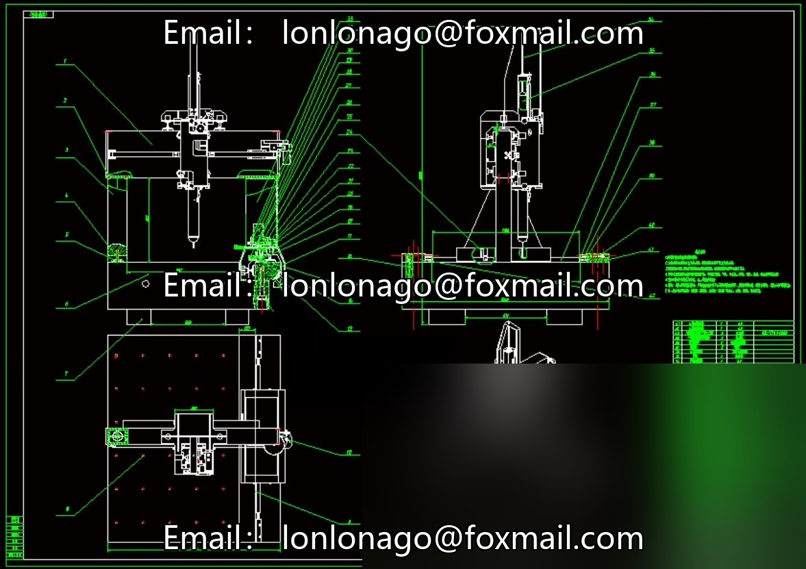
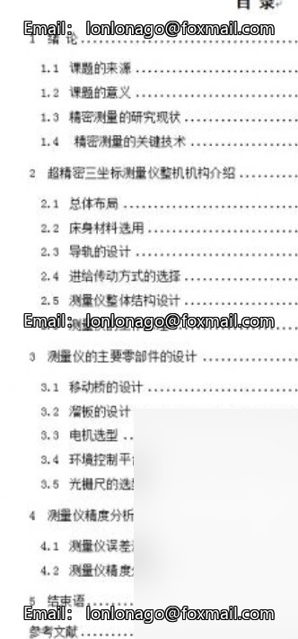

# Ultra-precision three-coordinate measuring instrument overall machine structure design

## Body

Precision three-coordinate measuring instrument whole machine mechanism design; three-coordinate measuring instrument whole machine mechanism design drawing; three-coordinate measuring instrument whole machine mechanism design CAD drawing
121 The study status and key techniques for precision measurement in coordinate measuring instruments are summarized in this design. The overall layout of the designed measuring instrument. The selection of materials for the bed body Guide design The selection of feeding method has been introduced. Selecting a fan-shaped gas static pressure guide rail， Synchronous serration belt and steel belt drive Drive using the friction rod.
Performed simple ANSYS analyses on the moving bridge and the slide plate, calculating the maximum deformation and straightness when the moving bridge is subjected to force.
Selecting a servo motor as the power source, and performing simple power calculations on it, analyzing the impact of the measurement instrument's working environment on its precision and its application environment.

Positioning adopts an open grating ruler, making a comparison on the selection of the grating ruler.
Finally, a precision analysis is conducted on the whole instrument, to identify error sources and comprehensively analyze precision.

The images show CAD designs for the three-coordinate measuring instrument's whole mechanism, including X, Y and Z axis friction components, assembly drawings, and a thesis document.

<!-- AI_ENRICHED -->

## Images

## Payment

Here is a pay link on Stripe ( https://buy.stripe.com/3cs8yP7sY87d0vu9AB ). Please contact me lonlonago@foxmail.com after funding $89, and I will send you a complete data files , thank you!

